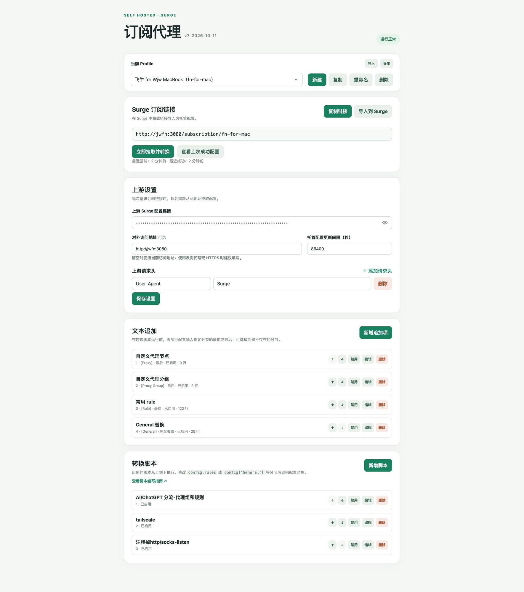

# Surge 订阅代理服务

[中文](README.md) | [English](README.en.md)

自己部署一个小服务：在网页上填一个订阅链接，它自动帮你加上自己的规则，再给 Surge 一个可以订阅的地址。



---

## 这个服务是干什么的

用 Surge 的人手里通常有一个**上游订阅链接**（机场或服务商给的地址），Surge 订阅它就能拿到节点和规则。

问题是：直接订阅上游，麻烦不少。

- 上游一更新，你自己加的规则、改过的分组就没了；
- 想改规则得去改 Surge 里的配置，每台设备都要重复改一遍。

这个服务就坐在中间当"二传手"：

```
上游订阅链接 ──► 本服务（拉取 → 文本追加 → 转换脚本 → 输出） ──► Surge 订阅这个地址
```

每次 Surge 刷新订阅，本服务都会重新去上游拉一份最新配置，先加上你写的规则，再执行你写的脚本，最后把完整的结果交给 Surge。你只在网页上改一次，所有订阅了这个地址的设备都会跟着更新。

**简单说：上游管节点，你管规则。**

## 准备工作

- 一台电脑：NAS、小主机、树莓派、云服务器都可以；也可以就用你平时装 Surge 的那台电脑，不需要另外找机器（不必一直开着，用的时候启动一下即可，见「只给本机的 Surge 用？按需启动就行」）；
- 这台电脑上装好 Docker（推荐），或者 Node.js 22 以上；
- 一个能返回**完整 Surge 配置**的上游订阅链接；
- 如果要在外网使用，先准备好 VPN 或内网穿透（见「安全提醒」）。

---

## 快速开始（Docker，推荐）

### 1. 下载代码

```sh
git clone <本仓库地址> surge-subscription-service
cd surge-subscription-service
```

### 2. 启动

```sh
docker compose up -d --build
```

### 3. 打开管理页

在同局域网的浏览器里访问：

```
http://这台机器的IP:3080/
```

例如 `http://192.168.1.10:3080/`。

### 4. 填上游链接

在「上游设置」里粘贴你的上游订阅链接，点「保存设置」。

第一次用不知道请求头怎么填？**不用填**，服务默认带上 `User-Agent: Surge`，多数上游都认。上游有特殊要求时再加。

### 5. 先拉一次看看

点「立即拉取并转换」。成功后会显示时间；点「查看上次成功配置」能直接看到最终结果。

### 6. 拿到订阅链接

页面上「Surge 订阅链接」这一栏里的地址就是给 Surge 用的。点「复制链接」复制；如果这台电脑上装了 Surge，也可以直接点「导入到 Surge」。

### 7. 在 Surge 里导入

Surge → 配置 → 通过 URL 下载配置，粘贴刚才复制的链接。之后 Surge 会按设定的间隔自动更新。

以后想改规则，回到这个网页改就行。

### 常用命令

```sh
docker compose logs -f        # 看日志（排查问题时用）
docker compose restart        # 重启
docker compose down           # 停止并删除容器（数据在命名卷里，不会丢）
docker compose up -d --build  # 更新代码后重新构建
```

如果这台机器上已经装了反向代理（Nginx、Caddy 等），可以只让本机访问：

```sh
HOST_BIND=127.0.0.1 docker compose up -d --build
```

## 不用 Docker，直接运行

需要 Node.js 22 或更高版本。项目没有任何第三方依赖，**不需要** `npm install`。

```sh
npm start
```

默认监听 3080 端口，浏览器打开 `http://127.0.0.1:3080`。

想换端口或换数据目录：

```sh
PORT=3081 DATA_DIR=./data node src/server.js
```

## 只给本机的 Surge 用？按需启动就行

不一定要一台长期开机的服务器。这个服务可以和 Surge 装在同一台电脑上，**用的时候启动，更新完就关掉**：

1. 在项目目录运行 `npm start`（需要 Node.js 22 以上）；
2. 浏览器打开 `http://127.0.0.1:3080`，填好上游链接和你要的规则；
3. 把页面上给的订阅链接导入 Surge，更新一次配置；
4. 看到 Surge 已经用上新配置后，在终端按 `Ctrl-C` 关掉服务。

**关掉之后照常使用。** Surge 会继续用上一次拿到的配置；本服务生成的托管链接不带 `strict` 参数，按 [Surge 官方说明](https://manual.nssurge.com/profile/managed-profile.html)，这种情况下更新失败不会影响你已经导入的配置，只是这一次没更新而已。

下次想改规则，重新 `npm start`，改完在 Surge 里手动更新一次配置即可。如果不想让 Surge 在你没开机的时候反复尝试更新，可以把「托管配置更新间隔」调大一些（最大 604800 秒，即 7 天），平时靠手动更新。

两个注意点：

- 订阅链接里的地址必须是**运行服务的那台机器**能访问到的。只给本机的 Surge 用，`127.0.0.1` 就可以；想让同一局域网里的手机也能订阅，在「对外访问地址」里填这台机器的局域网地址（例如 `http://192.168.1.10:3080`），并且手机更新时服务要开着。
- 想用 Docker 也行：加 `HOST_BIND=127.0.0.1` 启动，用完 `docker compose stop` 停掉。

---

## 网页上都能做什么

页面从上到下是五块，按使用顺序排列。

### 配置（Profile）

一套完整的设置叫一个 Profile。可以建多个，比如「手机用」「电脑用」「给家人用」，各自有不同的规则和订阅链接，互不影响。

- **新建 / 复制 / 重命名 / 删除**：复制会把设置和脚本一起复制一份（缓存不复制）；
- **导入 / 导出**：导出成一个 JSON 文件，方便备份或搬到另一台机器；导入时填个新 ID 就多出一套配置；
- 名字叫 `default` 的那套不能删除，兼容旧版本用；
- ID 必须以小写字母开头，只能包含小写字母、数字、下划线和连字符，最长 16 个字符，创建后不能改（因为订阅链接里会用到它）。

### 上游设置

告诉服务去哪儿拿原始配置。

| 项目 | 说明 |
| --- | --- |
| 上游 Surge 配置链接 | 你的上游订阅地址，必填 |
| 对外访问地址 | 选填。留空时按你当前访问的地址自动生成订阅链接；如果通过反向代理或 HTTPS 访问，填上完整地址（例如 `https://surge.example.com`），生成的链接才正确 |
| 托管配置更新间隔 | Surge 多久来更新一次，单位秒，范围 60–604800（默认 86400，即 24 小时）|
| 上游请求头 | 请求上游时带的 HTTP 头，默认只有 `User-Agent: Surge`，可以增删改 |

### 文本追加（不会写代码就用这个）

想把几行配置塞进某个分节，直接用这个，不用写 JavaScript。

举例：想让 `example.com` 走直连，就在「Rule」分节的最前面加一行 `DOMAIN-SUFFIX,example.com,DIRECT`。

每一条追加项包括：

- **名称**：随便起，方便自己认；
- **分节名**：要加到哪一段，比如 `Rule`、`Proxy Group`、`General`；
- **插入位置**：最前或最后；
- **分节不存在时创建**：勾上以后，上游没有这个分节也能自动建；
- **完全覆盖分节**：勾上表示用这段文字把整个分节替换掉，而不是插入；
- **启用**：随时开关，不用删除。

多条追加项按列表顺序依次执行，**先做文本追加，再跑脚本**。

### 转换脚本（会写 JavaScript 就用这个）

文本追加不够用时，可以写 JavaScript 改配置。脚本长这样：

```js
module.exports = (config) => {
  config.rules = [
    'DOMAIN,registry.hub.docker.com,节点选择',
    ...(config.rules || []),
  ];
  return config;
};
```

- 启用的脚本从上到下依次执行，后一个拿到的是前一个改完的结果；
- 配置对象可以直接按分节名访问，例如 `config['General']`、`config['Proxy Group']`，`config.rules` 是 `[Rule]` 的快捷写法；
- 编辑框支持行号、查找、自动换行，改完点「检查」只校验语法，不保存也不执行；
- 完整教程和更多例子见 [`docs/script-guide.md`](docs/script-guide.md)；服务网页内也有一份：管理页右上角的「查看脚本编写指南」。

### 订阅链接与状态

- **复制链接 / 导入到 Surge**：把当前配置的订阅地址复制走，或直接用 `surge:///` 唤起 Surge 导入；
- **立即拉取并转换**：马上拉一次上游，方便测试规则有没有生效；
- **查看上次成功配置**：看最终输出的完整内容，规则加没加进去一目了然；
- 失败时页面会显示具体错误（比如上游连不上、脚本第几行报错）。

---

## 出问题时怎么办

| 现象 | 先看这里 |
| --- | --- |
| 网页打不开 | 容器跑起来了吗（`docker compose ps`）；IP 和端口对不对；防火墙放行了吗 |
| Surge 里的配置没更新 | 点「立即拉取并转换」看报错；确认上游链接在浏览器里能打开 |
| 规则没生效 | 点「查看上次成功配置」搜一下自己的规则在不在；规则顺序会影响结果，注意别放在 `FINAL` 后面 |
| 脚本报错 | 页面会指出是哪个脚本、第几行；先用「检查」按钮单独校验 |
| 上游拉不下来 | 上游可能要求特定请求头，在「上游请求头」里补上；也可能是上游限制了 IP |
| 想换端口 | 改 `compose.yaml` 里的端口映射，或本地运行时设 `PORT` |

**服务不会因为拉取失败就返回空配置**：拉不到上游时，会把上一次成功的结果继续给 Surge，只是会标记为过期，管理页同时显示错误。所以配置不会突然失效。

## 安全提醒

- **管理页没有账号密码**，谁能访问这个地址，谁就能看到你的上游链接、改你的规则。所以**不要把它直接暴露到公网**：放在内网，或者配合 VPN / 内网穿透使用；加反向代理时也请自行加上访问控制。
- 数据文件里保存着**明文的上游链接和脚本**，备份、分享、上传前请先看清楚内容。
- 导出的 JSON 备份同样包含上游链接和请求头等敏感信息。
- 转换脚本是**你自己写的代码**，服务会直接执行它。不要粘贴来源不明的脚本——运行环境不构成安全隔离。

---

## 进阶说明

### 环境变量

| 变量 | 默认值 | 作用 |
| --- | --- | --- |
| `PORT` | `3080` | 服务监听端口 |
| `DATA_DIR` | `./data`（本地运行） | 数据保存目录；Docker 镜像里是 `/data` |
| `HOST_BIND` | `0.0.0.0` | 仅用于 `compose.yaml`，控制映射到宿主机的哪个地址，填 `127.0.0.1` 表示只允许本机访问 |
| `NODE_ENV` | — | Docker 镜像里设为 `production`，一般不用管 |

### 数据保存在哪

- 本地运行：`./data/state.json`；
- Docker：容器里的 `/data`，对应 compose 里名为 `surge-data` 的卷。

这个文件里放着所有 Profile 的设置、脚本、缓存和最近一次的错误信息。删掉它等于恢复出厂设置；备份它等于备份全部配置。

### 订阅链接的规则

- 每套配置的地址是 `/subscription/配置ID`，例如 `/subscription/phone`；
- 旧地址 `/subscription` 永远指向 `default` 这套配置，老用户不用改链接；
- 链接前缀由「对外访问地址」决定，没填就按当前访问地址自动生成；
- 每次请求都会重新拉上游并执行转换，不做定期后台刷新。

### 一次请求的完整流程

1. 收到 Surge 的订阅请求；
2. 去上游拉取最新配置（超时 15 秒，体积上限 15 MB）；
3. 解析成一个个分节（`[General]`、`[Rule]` 等），没被改动的位置原样保留，注释和空行也保留；
4. 按顺序执行你启用的文本追加项；
5. 按顺序执行你启用的脚本（单个脚本最长 500 毫秒，只支持同步代码）；
6. 在开头写上指向本服务的 `#!MANAGED-CONFIG` 行，返回给 Surge。

如果中间的拉取或转换失败：有上一次成功结果就返回它（响应头 `X-Subscription-Stale: true` 表示这是旧结果），没有就直接报错。拉取期间如果配置被改动，本次结果会作废并提示重试，避免出现「旧上游配新脚本」的混合配置。

### 主要接口

网页上的每个功能都有对应的 HTTP 接口，方便脚本化调用。

| 方法 | 路径 | 作用 |
| --- | --- | --- |
| GET / POST | `/api/profiles` | 列出 / 新建配置 |
| GET / PUT / DELETE | `/api/profiles/<id>` | 读取 / 重命名 / 删除配置 |
| POST | `/api/profiles/import` | 导入 JSON 备份 |
| GET | `/api/profiles/<id>/export` | 导出 JSON 备份 |
| GET / PUT | `/api/profiles/<id>/state`、`/settings` | 读取状态 / 保存上游设置 |
| GET / POST | `/api/profiles/<id>/preview`、`/refresh` | 查看上次成功配置 / 立即拉取 |
| POST | `/api/profiles/<id>/scripts`、`/scripts/validate` | 新建脚本 / 只校验语法 |
| PUT / DELETE | `/api/profiles/<id>/scripts/<脚本ID>` | 修改 / 删除脚本 |
| POST | `/api/profiles/<id>/scripts/<脚本ID>/move` | 调整脚本顺序 |
| POST | `/api/profiles/<id>/appends` | 新建文本追加项（`/appends/<ID>`、`/move` 同理）|

旧的单实例路径（`/api/state`、`/api/settings`、`/api/preview`、`/api/refresh`、`/api/scripts`）仍然可用，固定操作 `default` 配置。

### 一些限制

| 项目 | 上限 |
| --- | --- |
| 上游配置体积 | 15 MB |
| 拉取上游超时 | 15 秒 |
| 单个脚本运行时间 | 500 毫秒 |
| 脚本代码长度 | 100000 字符 |
| 脚本 / 追加项名称 | 100 字符 |
| 追加文本长度 | 100000 字符 |
| 更新间隔 | 60–604800 秒 |
| 请求体大小 | 1 MB |

---

## 开发与测试

```sh
npm start   # 本地启动
npm test    # 运行测试（Node 内置测试运行器，无第三方依赖）
```

项目只用 Node.js 内置模块，没有构建步骤，改完代码直接重启即可。

### 目录结构

```
src/server.js        HTTP 服务、管理接口、上游拉取与数据持久化
src/profile.js       Surge 配置的解析、脚本执行与序列化
public/              管理页面与脚本编写指南（随镜像发布）
test/                自动化测试
data/                本地运行的数据目录（已被 git 忽略）
compose.yaml         Docker Compose 部署入口
Dockerfile           镜像构建
```

## 参考链接

- [Surge Profile Format](https://manual.nssurge.com/profile/format.html)
- [Surge Managed Profile](https://manual.nssurge.com/profile/managed-profile.html)

## 许可证

[MIT](LICENSE)
